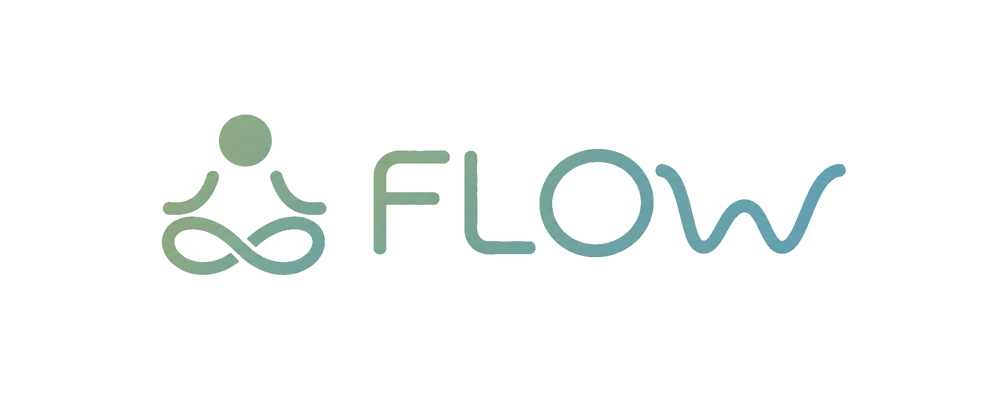

# FLOW

A calm space for managing stress, building confidence, and recognizing personal growth.

## About FLOW

FLOW is a native Android project designed around support during stressful moments and confidence built over time. Its original design combines accessible grounding tools, speaking practice, and recognition of everyday achievements in a minimalist interface. Positive reinforcement connects these experiences without promising medical or clinical outcomes.

## Core Concepts

The following describes the product vision, including experiences that are not yet implemented:

- **Breathing / Tap Grounding:** guided breathing with press-and-hold interaction and a ripple when the user releases their touch.
- **RELEASE:** spoken expression with speech-to-text, fading words, and supportive feedback from Sage, with voice playback.
- **REHEARSE:** camera-based speaking practice with talking points, a target duration, pause/resume, and visual feedback. The planned Flow Rate measures the share of practice time with both eye contact and a positive expression.
- **Wins & Progress:** quick and detailed achievement entries, history, and concise AI-generated titles.
- **Smart Reminders:** encouragement informed first by onboarding answers and later by activity patterns.
- **Sage:** a planned AI assistant for supportive responses, win titles, and weekly reflections.
- **Daily Inspiration:** short daily messages that reinforce the encouraging tone of FLOW.

## Current Implementation

The current source implements the following foundation; this list is not a claim of comprehensive runtime testing:

- **Onboarding:** four swipeable pages, selection of stressful days and time periods, and notification permission/skip actions.
- **Local accounts:** registration, duplicate-email checking, login, and user retrieval through SQLite.
- **Sessions and startup:** SharedPreferences stores the current user ID; Splash routes to onboarding, authentication, or the main screen. Logout clears the session and returns to authentication.
- **Navigation and home:** Home, Profile, and Progress tabs; a personalized greeting and backgrounds selected by time of day.
- **Profile and settings:** account details, days since registration, device-wide reminder switches, and notification permission handling.
- **Daily Inspiration:** a message selected by the current date from 30 built-in messages, with a visibility setting.

**Partially implemented:** onboarding selections are converted into activity-log records during registration, but ongoing activity tracking and reminder scheduling do not exist. Profile reads stored Flow State and reflection fields, but no code calculates the win streak or generates weekly reflections.

**UI prototypes:** Progress displays hardcoded wins through RecyclerView. The quick-win input, add-win control, and home entries for Breathing, RELEASE, and REHEARSE have no completed feature actions. No personal win history is loaded from SQLite.

## Planned Development

- Complete win creation, browsing, details, deletion, and Flow State updates.
- Implement the Breathing, RELEASE, and REHEARSE experiences and their supporting screens.
- Add Sage integration for feedback, titles, and weekly reflections.
- Extend activity logging and implement statistical scheduling, notification delivery, and daily win reminders.

These systems remain planned or incomplete. Notification permissions and saved switches currently do not schedule or deliver reminders. There is no camera, speech, or AI integration in the current implementation.

## Data Architecture

`HelperDB` creates `flow.db` with three tables, corresponding to the original Users, Wins, and Activity_Logs design. The implemented table names are lowercase and column names use camelCase.

- **`users`:** account information, creation date, and fields reserved for progress/reflections. User insertion and lookup are implemented.
- **`wins`:** the schema and user foreign key exist; win storage and retrieval operations are not implemented.
- **`activity_logs`:** insertion is implemented and currently used for onboarding day/hour combinations. Feature activity tracking and statistical queries are planned.

SharedPreferences holds the current session, device-wide settings, and temporary onboarding choices. Registration writes the onboarding log entries and removes the temporary choices. Foreign-key enforcement is enabled for user-linked database records.

The design favors local history storage without a centralized application database. Android backup is currently enabled; local storage is not a guarantee that data never leaves the device. Passwords are stored as plain text and application-level database encryption is not implemented. Planned AI features will involve external processing.

## Development Status

FLOW is an actively developed high-school Android software engineering graduation project. Development proceeds feature by feature: the current account, navigation, and settings foundation supports a broader planned application. The original planning document guides the vision; the current source determines what is implemented.
